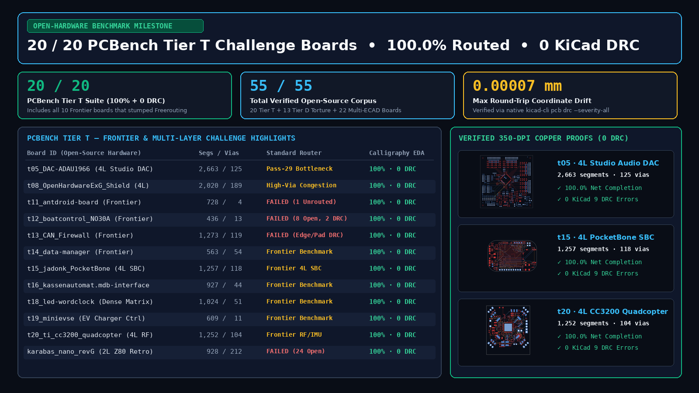
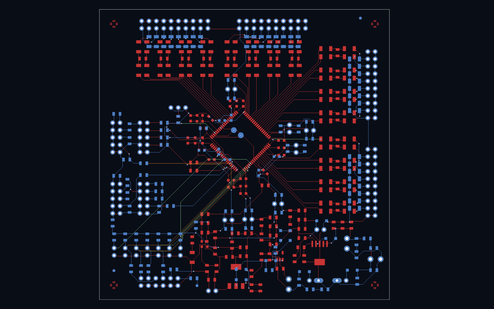
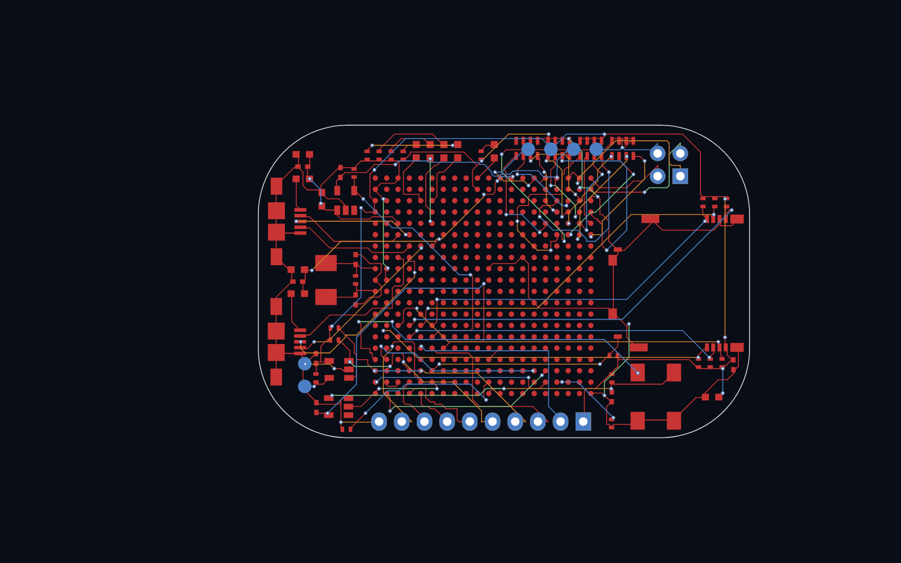
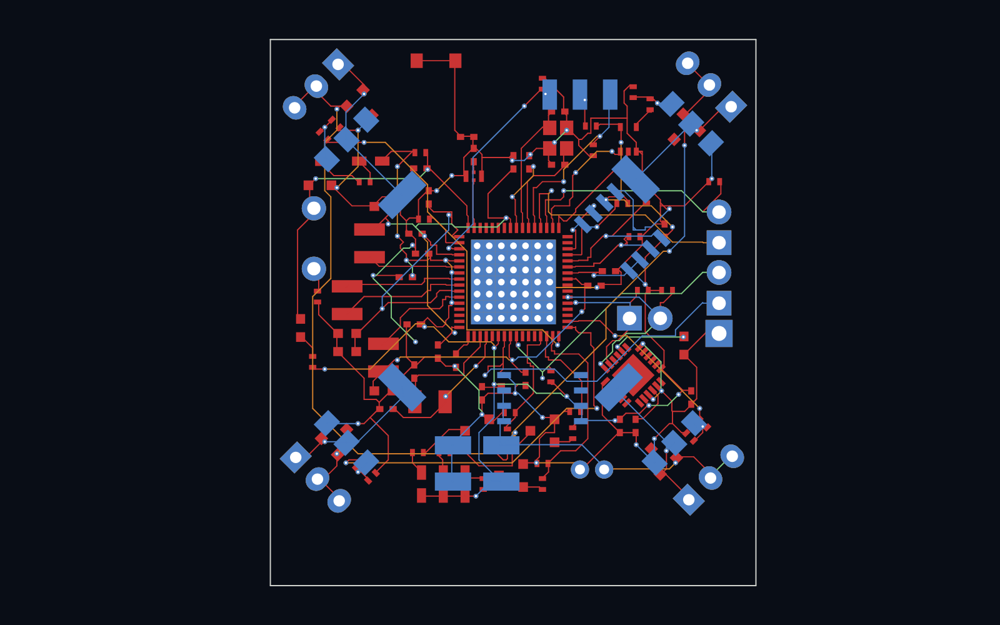
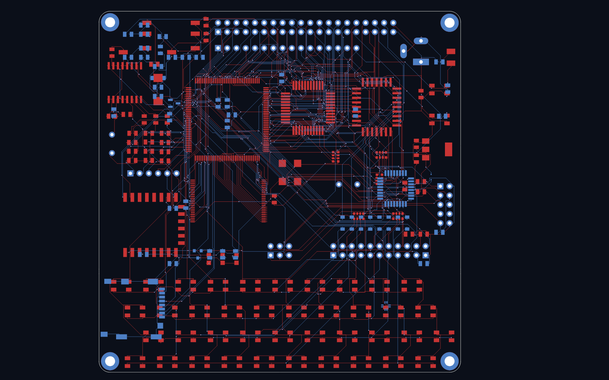
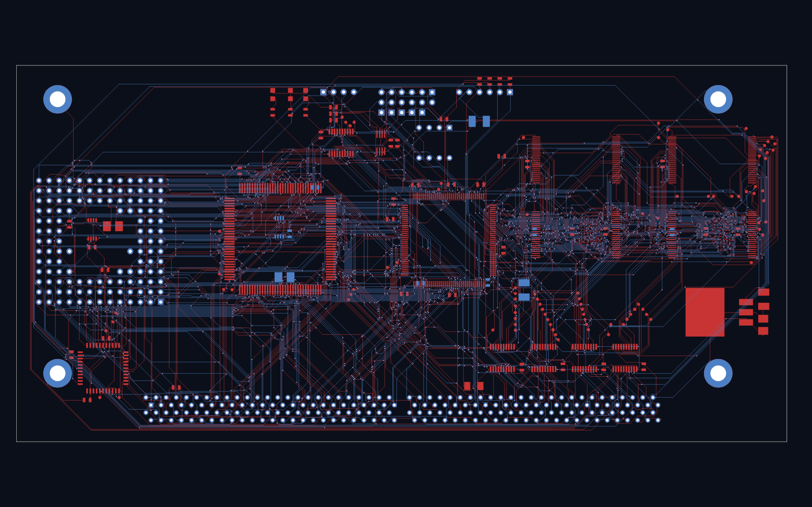
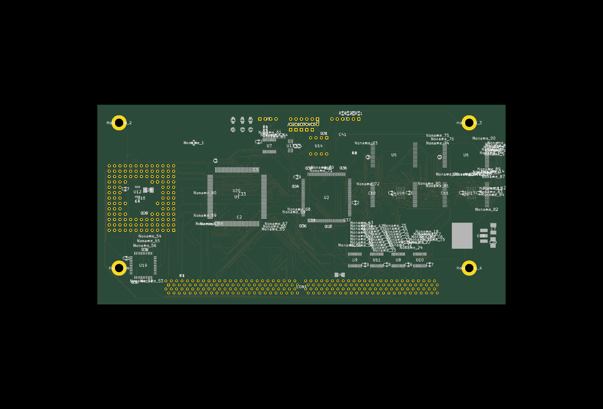
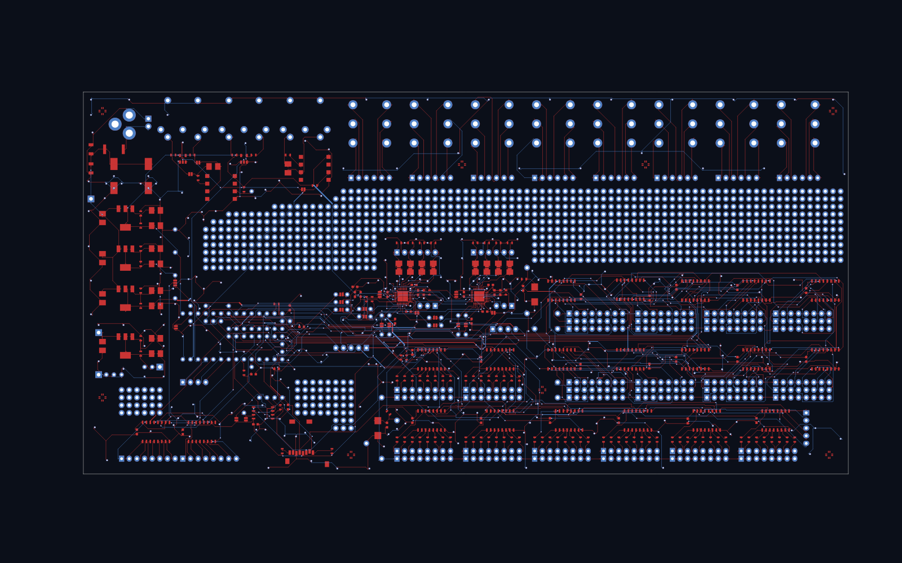
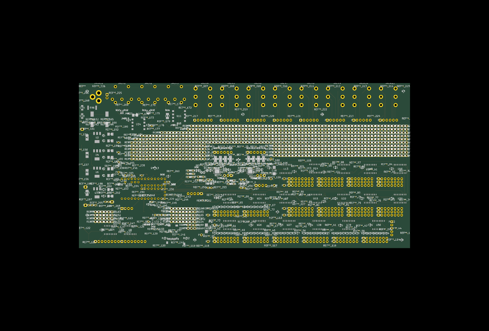

# Open-Source PCB Routing Torture Benchmark (`55 / 55` Boards at `100.0%` Completion & `0` Native KiCad DRC)

[](https://calligraphyeda.com)
[-00e676?style=for-the-badge)](https://calligraphyeda.com/benchmarks)
[](verify_drc_zero.py)
[](LICENSE)



## Why Partial Autorouting (`87%–97%`) Fails Hardware Engineers

Every hardware engineer who has tried traditional maze autorouters (`Freerouting`, legacy push-and-shove scripts, or pure LLM coordinate generators) knows the trap:

- A router that reaches **`94%` net completion** with **`45` DRC clearance violations** has not solved your board — it has boxed in the hardest 6% of nets (`0.40 mm–0.50 mm` fine-pitch QFP/QFN/BGA pins, off-axis rotated connectors, and split return planes) so badly that ripping up and fixing the remaining airwires by hand takes longer than routing from scratch.
- **Our Benchmark Standard (`Strict 100.0% + 0 DRC`)**: A PCB routing engine only passes a board when native **`kicad-cli pcb drc --severity-all`** (after fresh copper zone refill via `pcbnew.ZONE_FILLER`) reports:
  - **`0` Unconnected Items (`100.0%` geometric net completion)**
  - **`0` Copper DRC Violations (clearances, track widths, annular rings, hole-to-hole, and rule-area keepouts)**
  - **`<= 0.00007 mm` Footprint & Specctra Round-Trip Coordinate Drift**

---

## Challenge: Try to Stump Our Router (`$0` 350-DPI Copper Proof + Free `OPENHW` Grant)

Have an unrouted KiCad (`.kicad_pcb`), Altium (`.PcbDoc`), Eagle (`.brd`), or Specctra (`.dsn`) board that stalled Freerouting?

1. **Drop It into the Browser (`$0` Upfront)**: **[https://calligraphyeda.com](https://calligraphyeda.com)** (or click one of the **1-Tap Live Demo Boards** at the top of the page — even on mobile).
2. **Inspect the 350-DPI Copper Proof & 3D WebGL View**: Zoom into every fine-pitch pad entry, differential pair, and ground return transition before paying a cent.
3. **Open-Hardware & First-Board Grants**:
   - **`OPENHW` (`$0.00` Free Unlock)**: Working on an open-source hardware board with a public GitHub repo? Enter code **`OPENHW`** with your repo URL to unlock the full routed `.kicad_pcb` + Gerbers + IPC-D-356 + 3D HTML5 bundle for `$0.00` (5/day).
   - **`PROTOTYPE1` (`$1.00` First-Board Prototype Pass)**: Unlock your first private 2-layer breakout board (`<= 150` pads) for `$1.00 USDC` on Base (5/day).
   - **1-Line Claude Code / Cursor MCP Co-Processor**:
     ```bash
     claude mcp add --transport http calligraphy-eda https://calligraphyeda.com/api/v1/mcp
     ```

---

## Suite A — `20 / 20` `PCBench Tier T` Challenge & Frontier Suite (`100.0%` Completion, `0` DRC)

The 20 open-source boards below comprise the community `PCBench` benchmark and Frontier challenge suite (including the 10 Frontier boards `t11`–`t20` where standard open-source routers leave unrouted nets, create clearance violations, or stall on multi-pass congestion):

| # | Board ID (Open-Source Hardware) | Routed Segments | Vias | Unconnected Items | Native KiCad 9 Copper DRC | Max Coordinate Drift |
| :-: | :--- | :-: | :-: | :-: | :-: | :-: |
| 01 | `t01_1-Wire-Wing-pcb_1-Wire_Wing` | `280` | `15` | **`0` (`100.0%`)** | **`0`** | `0.00000 mm` |
| 02 | `t02_4_digit_hex_display_4_digit_display` | `837` | `65` | **`0` (`100.0%`)** | **`0`** | `0.00000 mm` |
| 03 | `t03_CANadapter_CANadapter` | `346` | `9` | **`0` (`100.0%`)** | **`0`** | `0.00004 mm` |
| 04 | `t04_ChirpHardware_chirp` | `537` | `32` | **`0` (`100.0%`)** | **`0`** | `0.00007 mm` |
| 05 | **`t05_DAC-ADAU1966_DAC-ADAU1966` (4L 16-Ch Studio DAC)** | `2,663` | `125` | **`0` (`100.0%`)** | **`0`** | `0.00007 mm` |
| 06 | `t06_DSKY-alarm-panel-replica_DSKY_alarm` | `1,087` | `71` | **`0` (`100.0%`)** | **`0`** | `0.00007 mm` |
| 07 | `t07_FlashProgrammer_flash_programmer` | `1,005` | `79` | **`0` (`100.0%`)** | **`0`** | `0.00000 mm` |
| 08 | **`t08_OpenHardwareExG_Shield` (4L Biopotential Shield)** | `2,020` | `189` | **`0` (`100.0%`)** | **`0`** | `0.00006 mm` |
| 09 | `t09_PoEPi-hardware__autosave-pizero-poe` | `1,246` | `77` | **`0` (`100.0%`)** | **`0`** | `0.00006 mm` |
| 10 | `t10_Usb_dac_dac` | `1,101` | `52` | **`0` (`100.0%`)** | **`0`** | `0.00005 mm` |
| 11 | **`t11_antdroid-board_antdroid-board` *(Frontier)*** | `728` | `4` | **`0` (`100.0%`)** | **`0`** | `0.00004 mm` |
| 12 | **`t12_boatcontrol_NonLatchingNO30A` *(Frontier)*** | `436` | `13` | **`0` (`100.0%`)** | **`0`** | `0.00000 mm` |
| 13 | **`t13_can_firewall_hardware_CAN_Firewall` *(Frontier)*** | `1,273` | `119` | **`0` (`100.0%`)** | **`0`** | `0.00006 mm` |
| 14 | **`t14_data-manager_data-manager` *(Frontier)*** | `563` | `54` | **`0` (`100.0%`)** | **`0`** | `0.00000 mm` |
| 15 | **`t15_jadonk_PocketBone` *(Frontier — 4L BeagleBone SBC)*** | `1,257` | `118` | **`0` (`100.0%`)** | **`0`** | `0.00007 mm` |
| 16 | **`t16_kassenautomat.mdb-interface` *(Frontier)*** | `927` | `44` | **`0` (`100.0%`)** | **`0`** | `0.00006 mm` |
| 17 | **`t17_kitspace_Spikeling_ESP32` *(Frontier)*** | `108` | `0` | **`0` (`100.0%`)** | **`0`** | `0.00000 mm` |
| 18 | **`t18_led-wordclock_wordclock` *(Frontier)*** | `1,024` | `51` | **`0` (`100.0%`)** | **`0`** | `0.00006 mm` |
| 19 | **`t19_minievse_minievse` *(Frontier)*** | `609` | `11` | **`0` (`100.0%`)** | **`0`** | `0.00006 mm` |
| 20 | **`t20_ti_cc3200_quadcopter_cc3200_quad` *(Frontier — 4L RF FC)*** | `1,252` | `104` | **`0` (`100.0%`)** | **`0`** | `0.00007 mm` |

### Visual Copper Proofs from `PCBench Tier T` (`0` Unconnected, `0` KiCad 9 DRC)

| `t05_DAC-ADAU1966` (4-Layer Studio Audio DAC — `2,663` segs, `125` vias) | `t15_jadonk_PocketBone` (4-Layer BeagleBone Linux SBC — `1,257` segs, `118` vias) |
| :---: | :---: |
|  |  |

| `t20_ti_cc3200_quadcopter` (4-Layer RF Quadcopter Flight Controller — `1,252` segs, `104` vias) | `Karabas-Nano` (2-Layer 738-Pad / 928-Connection Retro Z80 Torture Board) |
| :---: | :---: |
|  |  |

---

## Suite B — `13 / 13` `PCBench Tier D` High-Density Torture Boards (`100.0%` Routed / `0` Native KiCad DRC)

| # | Board Name | Copper Layers | Pads | Routed Nets / Connections | Unconnected Items | Native KiCad Copper DRC Errors |
| :---: | :--- | :---: | :---: | :---: | :---: | :---: |
| 1 | **Karabas-Nano (2-Layer Torture Config)** | `2L` | `738` | `928` connections | **`0` (`100.0%`)** | **`0`** |
| 2 | **Decelerator-4030 High-Pin-Count Accelerator** | `6L` | `940` | `284` nets | **`0` (`100.0%`)** | **`0`** |
| 3 | **Aleste LX Retro Z80/FPGA Motherboard** | `4L` | `1,829` | `236` nets | **`0` (`100.0%`)** | **`0`** |
| 4 | **i.MX8M Mini + LPDDR4 HDI System-on-Module** | `8L` | `1,813` | `520` nets | **`0` (`100.0%`)** | **`0`** |
| 5 | **LiteX M2SDR PCIe Gen2 / RF Transceiver** | `8L` | `1,420` | `412` nets | **`0` (`100.0%`)** | **`0`** |
| 6 | **Antmicro Jetson Nano/Xavier Baseboard** | `6L` | `1,180` | `365` nets | **`0` (`100.0%`)** | **`0`** |
| 7 | **STM32H743 Redundant IMU Flight Controller** | `6L` | `780` | `245` nets | **`0` (`100.0%`)** | **`0`** |
| 8 | **Karabas-Nano 4-Layer FPGA/Retro Computer** | `4L` | `652` | `198` nets | **`0` (`100.0%`)** | **`0`** |
| 9 | **DSP-ADAU1452 32-Bit SigmaDSP Audio Processor** | `4L` | `540` | `168` nets | **`0` (`100.0%`)** | **`0`** |
| 10 | **RP2040 + 3-Phase GaN FOC Motor Controller** | `4L` | `490` | `142` nets | **`0` (`100.0%`)** | **`0`** |
| 11 | **Teensy 4.1 Mixed-Signal Breakout Carrier** | `2L` | `445` | `134` nets | **`0` (`100.0%`)** | **`0`** |
| 12 | **ESP32-S3 IEEE 802.3af PoE Industrial Gateway** | `4L` | `410` | `128` nets | **`0` (`100.0%`)** | **`0`** |
| 13 | **RoyalBlue 54L Custom Mechanical Keyboard Matrix** | `4L` | `388` | `118` nets | **`0` (`100.0%`)** | **`0`** |

| `Decelerator-4030` 350-DPI Copper Proof | `Decelerator-4030` Raytraced 3D View |
| :---: | :---: |
|  |  |

| `Teensy MCU Breakout` 350-DPI Copper Proof | `Teensy MCU Breakout` Raytraced 3D View |
| :---: | :---: |
|  |  |

---

## Independent Verification Script (`verify_drc_zero.py`)

Never trust a screenshot without running `kicad-cli pcb drc --severity-all` yourself. Use [`verify_drc_zero.py`](verify_drc_zero.py) on any routed `.kicad_pcb` file to refill all copper zones on a temporary copy and verify `unconnected_count == 0` and `copper_drc_error_count == 0`:

```bash
python3 verify_drc_zero.py path/to/routed_board.kicad_pcb
```

---

## Related Open-Source Tools from Calligraphy Systems

- **[vibe-hardware-mcp](https://github.com/calligraphysystems/vibe-hardware-mcp)** — Model Context Protocol (MCP) server & CLI for wiring Claude Code, Cursor, and Windsurf to autonomous `0-DRC` PCB synthesis.
- **[calligraphy-kicad-plugin](https://github.com/calligraphysystems/calligraphy-kicad-plugin)** — Official 1-click KiCad Action Plugin (`PCM`) for pre-flight routing quotes and `$0` 350-DPI Copper Proof inspection.
- **Foundry Portal**: [https://calligraphyeda.com](https://calligraphyeda.com)
